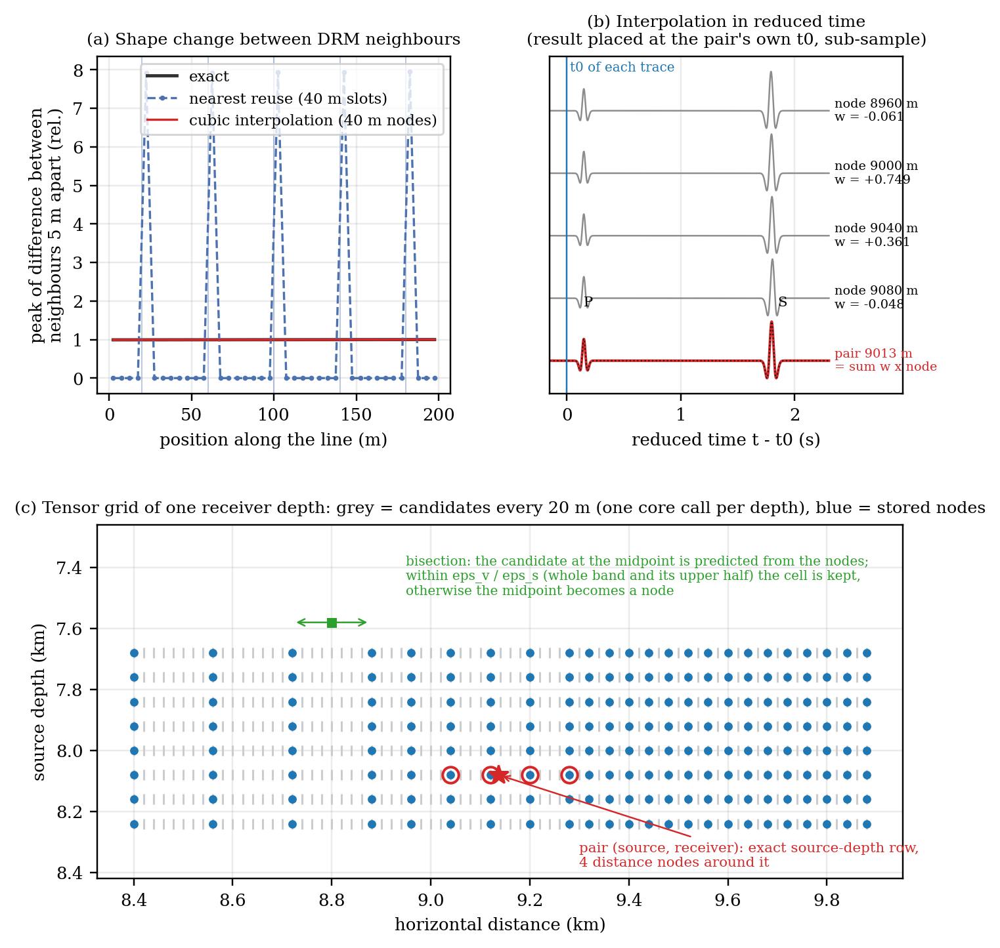
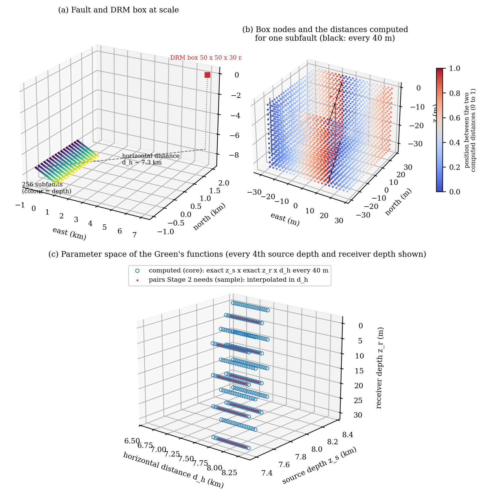
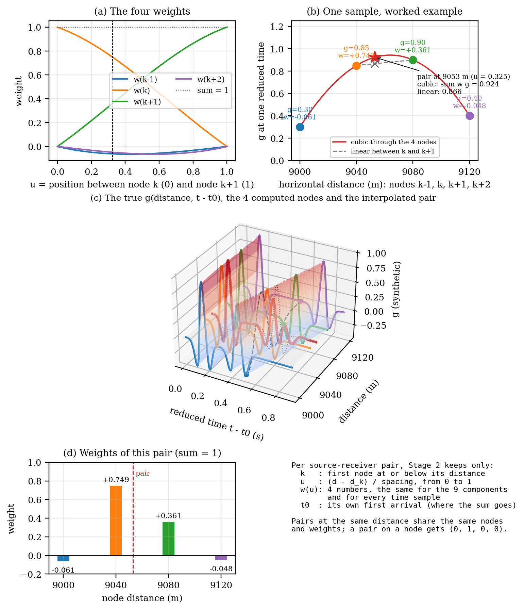
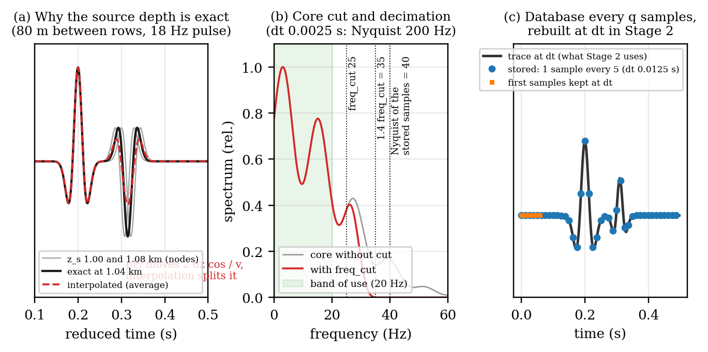
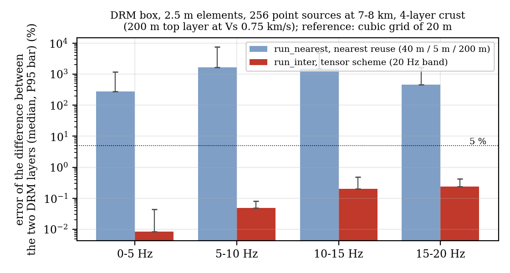
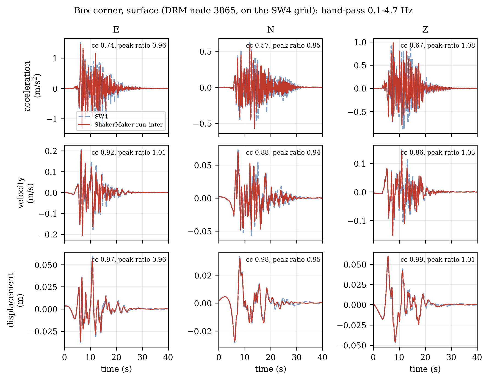
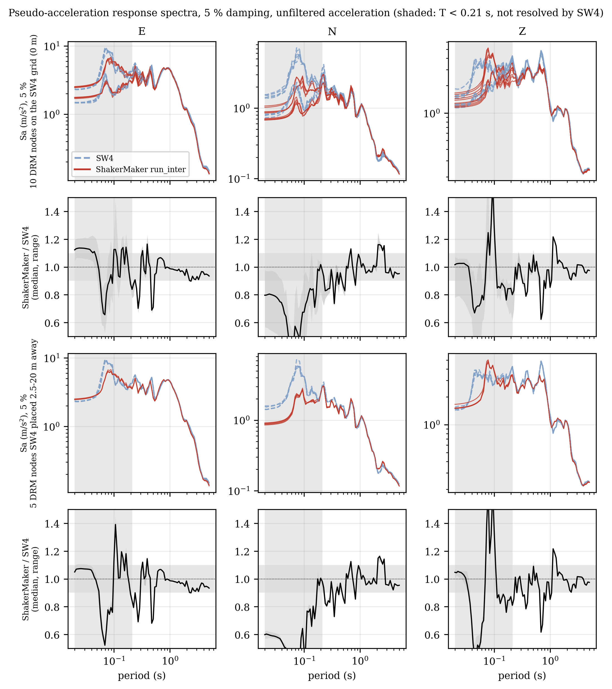

# Interpolated Green's functions (`run_inter`)

A DRM box or a dense receiver grid driven by a finite fault needs a Green's
function for every (source, receiver) pair: a box of 8 179 nodes and a
rupture of 32 768 subfaults is about 268 million pairs, almost all at a
different horizontal distance. Computing them one by one is out of reach, so
the engine computes a small set of Green's functions and builds every pair
from them. `run_nearest` does it by **reuse**: one Green's function per slot of
distance and depth. `run_inter` does it by **interpolation**: Green's
functions on a grid of distances, combined with weights. This page explains
why the difference matters for a DRM box, how the interpolation works, and
where its limits are. How to call it is in the
[run_inter guide](../guides/run_inter.md).

## The problem: a staircase across the DRM box

A layered (1D) crust makes the Green's function depend on three numbers only:
the horizontal distance $d_h$, the source depth $z_s$ and the receiver depth
$z_r$. `run_nearest` groups the pairs whose numbers fall within
`delta_h`, `delta_v_rec`, `delta_v_src` into one slot and computes one Green's
function per slot. Every pair of a slot gets the same waveform, placed at its
own first arrival.

That is harmless for a surface grid, but not for a DRM box. The DRM turns the
**difference between its two layers of nodes**, one element apart (2.5 to 5 m),
into effective forces. With reuse, two neighbouring nodes in the same slot get
identical waveforms (difference zero) and the waveform jumps at the slot edge
(difference up to eight times the true one). The jumps become spurious
high-frequency forces: a free-field finite element model fed with such a box
amplifies 4.5 to 7 Hz by 7 to 12 times and lets 32 % of the energy leave the
box. Lowering the tolerances does not remove it: with `delta_h` equal to the
node spacing the error is still ~10 %, and with many subfaults it does not
average out, it grows (the true difference partly cancels between
contributions, the errors of each copy do not).

{ width=640 }

*(a) Shape change between receivers 5 m apart along a line: exact (black),
nearest reuse with 40 m slots (dashed: zero inside a slot, jumps at its edges)
and cubic interpolation on 40 m nodes (red, on the exact one). (b) A pair at
9 013 m built from the nodes at 8 960, 9 000, 9 040 and 9 080 m in reduced
time. (c) The grid of one receiver depth: exact source-depth rows, candidate
distances every 20 m (grey), stored nodes (blue), the stencil of one pair (red)
and the bisection test of one cell (green). Synthetic pulses.*

## What is computed and what is interpolated

| Variable | `run_inter` | Why |
|---|---|---|
| $z_r$, receiver depth | **exact**, one per row of the box | near the free surface the wavefield is a standing wave: from one depth to the next the amplitude and shape change, there is no delay to interpolate; the rows are few |
| $z_s$, source depth | **exact**, one per row of subfaults | above ~5 Hz the surface-reflected phases (pP, sS) move the other way from the direct wave as the source goes deeper; averaging two depths splits the pP in two |
| $d_h$, horizontal distance | **interpolated**, cubic in reduced time | once every trace is aligned at its first arrival, the waveform changes slowly with distance in the far field |

{ width=640 }

*(a) Fault of 16 × 16 subfaults at 8 km and a 50 × 50 × 30 m DRM box at
scale. (b) For one subfault, the computed distances are vertical cylinders
around it (black, every 40 m); every node of the box falls between two of them
(colour: position between the two). (c) Parameter space: computed Green's
functions (blue circles, every source-depth row times every receiver depth,
along distance) and the pairs Stage 2 needs (red), always on a blue line: they
are interpolated along $d_h$ only.*

## How a pair is built: 4-point Lagrange in reduced time

Every computed node trace starts at its own first arrival $t_0$ (reduced time
$\tau = t - t_0$). A pair at distance $d_h$ between nodes $k$ and $k+1$, at the
fraction $u = (d_h - d_k)/\Delta$ of the cell, takes the four nodes
$k-1 \dots k+2$:

$$
g_\text{pair}(\tau) = \sum_{q=0}^{3} w_q(u)\, g_{k-1+q}(\tau),
$$

$$
w_{k-1} = -\frac{u(u-1)(u-2)}{6},\quad
w_{k} = \frac{(u+1)(u-1)(u-2)}{2},\quad
w_{k+1} = -\frac{(u+1)u(u-2)}{2},\quad
w_{k+2} = \frac{(u+1)u(u-1)}{6}.
$$

The weights are the Lagrange basis polynomials of the points −1, 0, 1, 2: they
sum to one, a pair on a node gets (0, 1, 0, 0), the side weights are small and
negative (at most −0.0625) and correct the curvature, and they change
continuously with $u$, so two neighbouring nodes of a box get almost the same
weights. The same four weights apply to all nine components and to every
sample; the result is placed at the pair's own $t_0$, fraction of a sample
included. Stage 2 keeps, per pair, only the first node $k$, the fraction $u$
and $t_0$; the database stores the node traces only.

Worked example ($u = 0.325$, one sample of the four node traces 0.30, 0.85,
0.90, 0.40): the weights are −0.061, +0.749, +0.361, −0.048 and the pair value
is 0.924; linear interpolation between the two central nodes gives 0.866.

{ width=600 }

*(a) The four weights against $u$. (b) The worked example at one sample.
(c) A synthetic Green's function as a surface over distance and reduced time:
the four computed node traces (colour), the pair built from them (red) on the
exact one (dotted), and one time sample across distance (dashed), the cut shown
in (b). (d) The weights of the pair and what Stage 2 keeps per pair.*

## Which distances are computed: candidates and bisection

For every level (one receiver depth and one source depth) the engine computes
the distances its sources and receivers need, every `dh_min`, in core calls of
up to 64 distances that share the wavenumber kernel: each extra distance costs
about 5 % of a call, and all of them use the wavenumber step of the largest
distance of the level, so nodes are consistent with each other. Which
candidates become nodes is decided without new calls, by bisection on their
band-limited spectra:

1. start with nodes every `dh0` (default 2 × `dh_min`);
2. in every cell, predict the candidate at the midpoint from the nodes;
3. accept the cell if the prediction is within `eps_v` (relative value error)
   and `eps_s` (error relative to the change across the cell, which is what a
   DRM layer turns into forces), **in the whole band `[0, f_err]` and in its
   upper half** (the error over the whole band is ruled by the energetic low
   frequencies);
4. otherwise the midpoint becomes a node and both halves are tested again.

Nodes end up dense where the waveform changes fast and sparse where it changes
slowly. Each level is selected and written as soon as its calls are back, so
the memory of Stage 1 is that of the levels in flight, not of the model.

## Frequency cut and the reduced database

The time step of the output is set by the stability of the finite element
model (for example 0.0025 s), which can represent up to 200 Hz; the band of use
is usually 5 to 20 Hz. `freq_cut` stops the FK frequency loop at
1.4 × `freq_cut` with a cosine taper from `freq_cut`. Every frequency is
integrated on its own, so below `freq_cut` nothing changes; the core becomes 33,
57, 122 and 292 times faster for bands of 20, 15, 10 and 5 Hz (`freq_cut` =
1.25 × band), with traces in the band equal to ~1e-5.

Since a trace then has nothing above 1.4 × `freq_cut`, the database keeps only
one sample every $q$ (the Nyquist of the stored samples is at least 1.1 × 1.4 ×
`freq_cut`), plus the first samples at full rate (the damping correction
$e^{\sigma t}$ of the core is not periodic, so the trace start is not
band-limited), and Stage 2 rebuilds the full-rate samples with a Kaiser
low-pass. Only the samples Stage 2 uses are stored (up to `tmax`), compressed
with ZFP (20 bits) or zstd. The output (`.h5drm`) keeps the time step asked
for.

{ width=640 }

*(a) Why the source depth is computed exactly: two sources 80 m apart in depth,
aligned at P; their average splits the pP. (b) Core spectrum without and with
the frequency cut, the band of use and the Nyquist of the stored samples.
(c) Stored samples (every 5) and the trace rebuilt at the full rate.*

## Stage 2

For every source, the receivers are grouped by level; the distance nodes a
group needs are read once and convolved once with the source time function.
Then, per receiver, the four distance nodes are combined and projected on the
vertical, radial and transverse components first and placed with the four
time taps after (64 operations per output sample instead of 208 when every
node is added on its own with the taps inside).

## Limits: when interpolation fails

Reduced time aligns only the first arrival. Any later phase (S, reflections,
surface waves) moves with respect to it by $\delta t \approx \Delta p \,
\Delta x$ between two nodes $\Delta x$ apart, where $\Delta p$ is the
difference of horizontal slowness between that phase and the first arrival.
When $\delta t$ becomes a sizeable fraction of a period the cubic mixes
misaligned traces. A working rule:

$$
f_\text{max}\;\Delta p\;\Delta x \;\lesssim\; 0.1 .
$$

- **Far field** (distance much larger than the depth difference, sources deep
  in fast rock): all phases arrive steeply, $\Delta p \approx 0.05$ s/km, and
  20 to 80 m nodes are enough up to 20 Hz.
- **Near field** (source in a slow shallow layer, receivers at a similar depth,
  distance below ~1 km): waves travel almost horizontally and $\Delta p
  \approx 1/V_s - 1/V_p$ of that layer, e.g. 0.6 s/km for $V_s$ = 0.75 km/s; at
  20 Hz the nodes must be closer than ~8 m. With `dh_min` = 20 m a point source
  100 m deep with a box 0.5 km away gives errors of 24 % at 15–20 Hz; with 5 m,
  0.3 %.

The bisection cannot split a cell below `dh_min`. When a cell with one
candidate inside still misses `eps_v`, Stage 1 counts it and reports the
largest error at the end:

```text
[Stage 1 tensor] WARNING: 84 distance cells miss eps_v at their midpoint and cannot
be split below dh_min = 20.0 m (largest value error 173.3 %, tolerance 1.0 %).
A large error is typical of the near field: use a smaller dh_min.
```

A largest error of tens of percent or more means the interpolation failed
there; a few percent means the tolerance is only slightly exceeded.

## Validation

All with the tensor scheme and the default tolerances, against Green's
functions computed for every pair (no reuse, common wavenumber step) unless
stated otherwise.

| Case | Result |
|---|---|
| DRM box, 2.5 m elements, 3 075 nodes; 4-layer crust with a 200 m top layer at $V_s$ 0.75 km/s; point source at 8 km | difference between the two layers 0.80 % (P95 1.5 %) at 20 Hz; nearest reuse 43 % (P95 207 %) |
| same box, 256 point sources (2 × 2 km patch) at 7–8 km | 0.20 % (P95 0.49 %) at 15–20 Hz with 4 032 nodes; nearest reuse 457–1 631 % (median per band) |
| five-layer crust (phase crossings), point source at 2 km, box at 10 km | 0.58 % (P95 1.4 %) at 15–20 Hz, with 170 nodes instead of 2 179 |
| free-field finite element model fed with the box | Fourier ratio at 4.5–7 Hz 1.01–1.02 and 0.005 % of the energy leaving the box (nearest reuse: 7–12 and 32 %) |
| bands of 15, 10 and 5 Hz | all within 5 % (10 Hz needs `dh0` = 2 × `dh_min`, the default) |

{ width=520 }

**Against SW4.** A DRM box of 8 179 nodes (105 × 105 × 30 m, 2.5 m) driven by a
rupture of 32 768 subfaults at 2.9–13 km, 6.5–24 km away, in the same 4-layer
crust, against an independent SW4 model (elastic, 20 m grid near the surface,
resolved up to ~4.7 Hz), at the box nodes that fall on the SW4 grid (band
0.1–4.7 Hz):

- displacement: correlation 0.975–0.988, peaks within 5 %;
- velocity: correlation 0.87–0.92, peaks within 5 %;
- 5 %-damped response spectra between 0.5 and 5 s: median ratio 0.97–0.99;
- acceleration and periods of 0.2–0.5 s: lower agreement (correlation
  0.57–0.74), the same with Green's functions computed for every pair, so it
  is a difference between the FK solution and SW4 in this crust (a 200 m layer
  at 0.75 km/s), not an interpolation error.

{ width=640 }

{ width=640 }

**Cost** of that box (dt 0.005 s, 10 Hz band, 64 MPI processes on 4 nodes):
Stage 1 34 min (172 683 nodes, database 10.7 GB), Stage 2 38 min (output
7.7 GB); the memory of Stage 1 stays constant.
