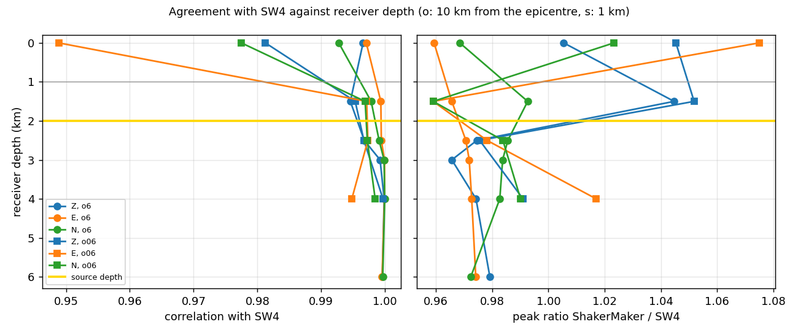

# 15 · LOH.1 with receivers above and below the source (ShakerMaker vs SW4)

Check the FK engine for **receivers deeper than the source** against the **SW4**
finite-difference solver, on the SCEC LOH.1 model (a 1 km slow layer over a half-space,
a vertical strike-slip point source at 2 km depth).

When a receiver is deeper than the source, the FK core (`subgreen.f`, `subgreen2.f`,
`subrt.f`) turns the layered model upside down so that the receiver is above the source
(the *flip* of Zhu's `fk.f`). SW4 has neither the flip nor a wavenumber integral, so it is
an independent reference for those receivers. Ten receivers on two verticals, from the
surface to 4 km below the source:

| Vertical | Epicentral distance | Depths (km) |
|---|---|---|
| (6, 8) km, the LOH.1 receiver | 10 km | 0, 1.5, 2.5, 3, 4, 6 |
| (0.6, 0.8) km, `sta01` of the SW4 LOH.1 example | 1 km | 0, 1.5, 2.5, 4 |

## Result

Both solutions band-passed to 0.1–1.2 Hz (SW4 reports a resolved bandwidth of 1.234 Hz for
this grid), first 9 s, one amplitude factor fitted at the surface receiver `o6_z0000` and
applied to every receiver, default `kc = 15` (`data/`, `notebooks/comparison.csv`):

| Receivers | Correlation with SW4 (Z, E, N) | Peak ratio ShakerMaker / SW4 |
|---|---|---|
| 1–4 km below the source, both verticals | 0.995–1.000 | 0.97–1.02 |
| 0.5 km below the source, 10 km from the epicentre | 0.997–0.999 | 0.97–0.99 |
| 0.5 km below the source, 1 km from the epicentre | 0.997 | 0.98 |
| 0.5 km above the source, both verticals | 0.995–0.999 | 0.96–1.05 |
| surface, 10 km / 1 km from the epicentre | 0.993–0.997 / 0.949–0.981 | 0.96–1.01 / 1.02–1.08 |

- The receivers below the source match SW4 in shape and amplitude: the flipped-model path is
  correct.
- The receivers 0.5 km from the source depth are converged in the wavenumber cut-off: `kc` = 15,
  30, 60 and 150 give the same seismograms (`kc_check.py`). The FK kernels decay with
  wavenumber like exp(−k·dz), with dz the source–receiver depth separation, and `subfk.f` cuts
  the integral at `kc / hs`. `subgreen` used to pass `hs` = the total thickness of the layered
  model; it now passes the source–receiver separation, as `fk.f` does. Before that change the
  vertical component 0.5 km below the source near the epicentre had a peak ratio of **1.36**
  (correlation 0.978) with `kc = 15` and needed `kc` ≥ 30 to converge.
- The surface receiver 1 km from the epicentre has the lowest correlation of the set (0.95 on E):
  it is in the near field of the source, where the 100 m SW4 grid is coarsest relative to the
  wavefield.



## Run

```bash
python run_shakermaker.py     # ShakerMaker, 10 receivers, a few seconds -> _output/sm_*.npz
python compare.py             # ShakerMaker (data/sm) vs SW4 (data/sw4) -> _output/comparison.csv, .png
python kc_check.py            # receivers 0.5 km from the source with kc = 15, 30, 60, 150 (converged)
```

`compare.py [SW4_DIR] [SM_DIR]` takes other directories (e.g. `_output` after
`run_shakermaker.py`). The notebook `notebooks/loh1_below_source.ipynb` runs ShakerMaker,
reads the SW4 output and makes all the tables and figures, step by step.

To regenerate the SW4 reference (about 25 min on 4 MPI ranks, 2.7 GB):

```bash
mpirun -np 4 sw4 loh1_below_source.in       # writes sw4_out/<receiver>.txt
cp sw4_out/*.txt data/sw4/
```

## Conventions used in the comparison

- Coordinates: km from the epicentre, x north, y east, z depth. SW4 receivers are written with
  `nsew=0` (x, y, z components); x = north and y = east in both codes, and the z components of
  both outputs have the same sign (checked at the surface receiver).
- Source time function: the two codes define the Gaussian differently. With
  `Gaussian(derivative=False)` the ShakerMaker output equals the time integral of the SW4
  velocity for `type=Gaussian` (correlation 0.99 at the surface receiver on the three
  components, no lag; the notebook shows the check). SW4's velocity is integrated in time
  before the comparison.
- SW4 domain: 24 × 24 × 12 km (smaller than the 30 × 30 × 17 km benchmark; every receiver is
  within 10.8 km of the source and the supergrid layers absorb the rest), h = 100 m refined to
  50 m in the 1 km layer, 9 s.

## Files

| Path | What |
|------|------|
| `receivers.txt` | the ten receivers (north, east, depth in km from the epicentre) |
| `run_shakermaker.py` | ShakerMaker run (same crust, source and FK parameters as `12_validation/LOH1.py`) |
| `loh1_below_source.in` | SW4 input for the same model, source and receivers |
| `compare.py` | ShakerMaker vs SW4 comparison: table and trace figure |
| `kc_check.py` | convergence of the receivers 0.5 km from the source in the wavenumber cut-off `kc` |
| `data/sw4/<receiver>.txt` | SW4 velocity time series (USGS ascii, `variables=velocity`) |
| `data/sw4/sw4_run_log.txt` | SW4 log of the reference run (grid, time step, timing) |
| `data/sm/sm_<receiver>.npz` | ShakerMaker reference output (Z, E, N, t; first 12 s) |
| `notebooks/loh1_below_source.ipynb` | the whole workflow as a notebook, with its outputs |
| `notebooks/comparison.csv`, `notebooks/kc_check.csv` | the tables of the notebook |
| `notebooks/*.png` | model and receivers, traces of both verticals, agreement against depth, `kc` check |

## Dependencies

`numpy`, `scipy`, `pandas`, `matplotlib`. SW4 only to regenerate `data/sw4/`.
